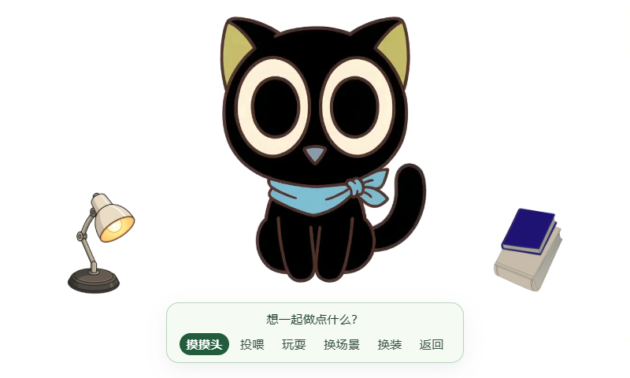

# 光崽 · 罗小黑 V2.0

光崽是为桌面反射装置做的陪伴型宠物。打开网页就能摸头、投喂、陪小黑玩或一起自习。它会记住你的称呼和完成过的互动，随成长解锁新的动作、服装和场景。罗小黑版使用 MiniMax 动画和纯白背景，也能在电脑上用键盘模拟装置按键与红外。



## 电脑试玩

需要 Python 3.10 或更新版本，以及近期版本的 Edge 或 Chrome。电脑试玩使用 Python 标准库，启动后就可以体验本地养成、记忆和投影。

在 GitHub 点 **Code → Download ZIP**，解压后双击 **启动.bat**。也可以在终端克隆并启动。

```powershell
git clone https://github.com/chana2887/guangzai.git
cd guangzai
python server.py --open
```

- 控制台打开在 [http://127.0.0.1:8780/](http://127.0.0.1:8780/)。这里可以打字聊天、直接触发动作、看成长和记忆簿。
- 白底投影打开在 [http://127.0.0.1:8780/?projection=1](http://127.0.0.1:8780/?projection=1)。投影显示角色、道具和气泡。自习中也会显示计时。按 **G** 或双击画面切回控制台。
- 按 **← / → / Enter** 模拟装置的三个按键。第一下打开菜单，左右选，中键确认。按 **A / D** 模拟左右红外，按 **↓** 模拟双侧。也可以直接点控制台里的模拟按钮。

想在演示时更快看到待机动作和主动搭话，启动时加上 `--demo`。独立存档可用 `--data-dir`，端口被占用可用 `--port`。

```powershell
python server.py --demo --port 8784 --data-dir data/demo --open
```

## 目前能玩什么

| 功能 | 体验方式 |
| --- | --- |
| **互动记忆** | 三键菜单选「玩耍 → 一起玩」，等动作播完。重启后再打开「玩耍」，或者问「你还记得我们上次一起玩吗？」。点「晚点吧」只回一句，不会记成玩过。 |
| **称呼和偏好** | 打字说「以后叫我小王」或「我喜欢薄荷茶」，之后打招呼、问「我喜欢什么？」就能试回忆。更新后采用最新说法，记忆簿可查看旧记录。 |
| **养成和性格** | 摸头、投喂、玩耍、自习会带来不同的性格变化。小黑的饱腹、精神和陪伴状态会影响待机小动作与主动搭话。 |
| **成长和装饰** | 60 经验解锁转头后挥爪与蓝围巾，180 经验解锁书房与主动自习邀请。「换场景」和「换装」分别保存，重启后可继续用之前的搭配。 |
| **自习计时** | 控制台可选 5、15、25 或 45 分钟。接受小黑的主动邀请会开始 25 分钟自习。完成后进入 5 分钟休息。 |
| **记忆簿** | 查看称呼与偏好、互动对话、成长日记，可搜索和导出 JSON。默认使用本机 SQLite 存档 `data/guangzai.sqlite3`。 |

## 动画与白底投影

目前接入 **27 段 MiniMax MP4**，包含 21 段基础动画和 6 段蓝围巾变体。待机、双向转头、挥爪、摸头、投喂、玩耍、睡眠和自习等会随状态切换。书房台灯与书本是两张独立透明 PNG，投影时和角色、气泡一起受画面校准控制。

组员要替换片段时，把 MP4/WebM 放到 `public/animations/`，按动作 ID 填写清单中的 `clips`。围巾变体填 `outfits.scarf`，台灯和书本填 `scenes.study`。替换素材采用白底或透明背景，保持同一构图，并给对白留出下方空间。只交付普通版的动作会播放普通片段。[当前动画清单](public/animations/manifest.json) · [动画交接规格](docs/联调.md#动画组交付)

角色造型参考《罗小黑战记》。[角色介绍](https://luoxiaohei-movie.com/tv/character/)

## 接入 API 对话

默认可以离线使用本地互动、记忆与简单对话。要体验由大模型回答的自由聊天，先在 DeepSeek 平台创建自己的 API Key，再从项目目录启动。

```powershell
python server.py --deepseek --open
```

程序读取本机 `DEEPSEEK_API_KEY`，也支持在启动时的终端提示中隐藏输入。打开控制台，试问「`e^x` 在 `x=0` 处的泰勒展开是什么？」。收到模型回复后，输入框下方显示「模型对话」，同一条回复也会出现在投影气泡里。密钥放在本机，别贴到群里或提交到 Git。[DeepSeek API 接入文档](https://api-docs.deepseek.com/)

也可以接入兼容 Chat Completions 的服务。在启动终端配置下列环境变量，然后运行 `python server.py --open`。

| 环境变量 | 填写内容 |
| --- | --- |
| `GUANGZAI_CHAT_URL` | 完整的 Chat Completions 地址。远程服务用 HTTPS，本机模型可以用 HTTP。 |
| `GUANGZAI_CHAT_MODEL` | 服务端提供的模型 ID。 |
| `GUANGZAI_CHAT_KEY` | 服务需要认证时使用的 API Key。 |

显式记忆的保存与回忆走本机数据库。调用远程模型时，当前问题、最多三轮近期对话和少量记忆摘录会发给模型服务。接口超时或不可用时，程序会返回本地回复。

## 组内联调

第一次接 ESP32，请从[软硬件交接与台架验收单](docs/esp32-handoff.md)开始。先在电脑上用 USB 跑通红外、转台和投影，再按文中的接口约定补齐三个实体键。

- **软件组**用 `server.py` 启动本地服务。提交前可运行 `python -m unittest discover -s tests -v`。
- **动画组**按 [动画与硬件联调](docs/联调.md) 交付动作和分层道具，并用白底投影核对朝向、循环接缝和对白留白。
- **硬件组**在 Raspberry Pi OS 桌面用 `bash kiosk.sh` 启动 Chromium 投影。ESP32 通过 USB 串口传红外与转台状态，串口模式需要 `pyserial`。三个实体键和最终反射效果在样机上联调，电脑上可以先用模拟控件。[串口与树莓派说明](docs/联调.md)
